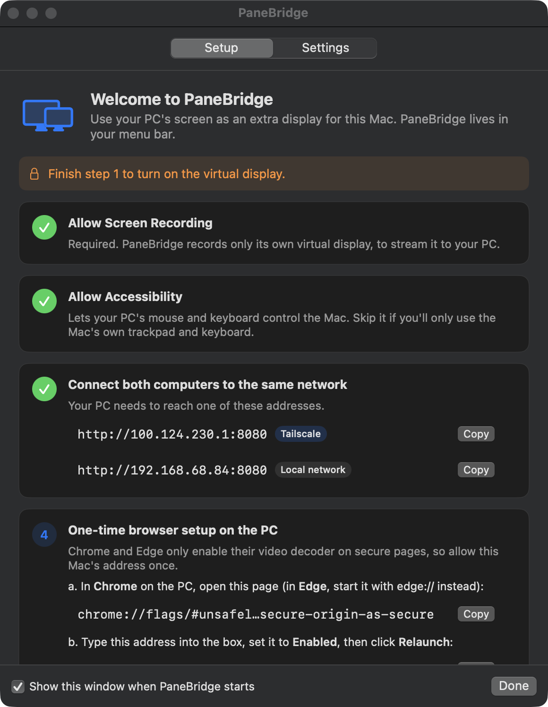
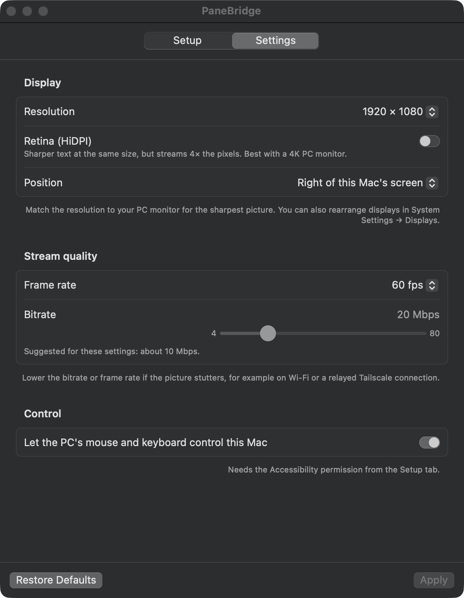

# PaneBridge

Use a Windows PC (or any computer with Chrome or Edge) as an **extra monitor for your Mac** over your home network.

PaneBridge adds a real virtual display to macOS, captures it, encodes it with the Mac's hardware H.264 encoder and streams it to a web page. On the Windows side you just open a URL. Nothing to install there.

<p align="center">
  
  
</p>

```
Mac                                                     Windows PC
┌───────────────────────────────────────────┐           ┌────────────────────────┐
│ CGVirtualDisplay  → ScreenCaptureKit      │           │ Chrome / Edge          │
│ (extra monitor)     (grab frames)         │  Wi-Fi /  │  WebCodecs decoder     │
│        → VideoToolbox H.264 (low latency) │  Ethernet │  → <canvas> fullscreen │
│        → WebSocket :8081  ────────────────┼──────────▶│                        │
│ CGEvent injection ◀── mouse/keys (JSON) ◀─┼───────────┤  pointer/keyboard      │
│ HTTP :8080 serves the viewer page         │           │                        │
└───────────────────────────────────────────┘           └────────────────────────┘
```

## 1. Install

### Option A: download the app (easiest)

1. Download `PaneBridge-x.y.z.dmg` from the [Releases](../../releases) page and drag **PaneBridge** into Applications.
2. The app isn't notarized by Apple, so the first time you open it, **right-click → Open → Open**. If macOS still blocks it, go to System Settings → Privacy & Security, scroll down and click **Open Anyway**.
3. The **setup guide** opens and walks you through everything: permissions, network, the one-time browser setting on your PC, and connecting. It ticks each step off as you go.
4. After that, PaneBridge lives in the **menu bar** (display icon). From there you can copy the PC address, reopen the **Setup Guide**, open **Settings** or quit.

**Settings** (menu bar → Settings…): resolution, Retina, which side of your Mac the display sits on, frame rate (24–120 fps), bitrate (4–80 Mbps) and whether the PC's mouse and keyboard can control the Mac. Changes apply in a couple of seconds, and the PC reconnects by itself.

> **Permissions now survive updates (0.2.2+).** Builds are signed with the same certificate, so macOS recognizes each update as the same app. When upgrading **from 0.2.1 or earlier**, grant Screen Recording one last time. If the switch already looks on, use **Reset permission** in the setup guide.

### Option B: build from source

```bash
cd PaneBridge   # the folder you cloned or downloaded
swift build -c release
```

## 2. Run from Terminal (optional)

Running the bare binary gives a headless version that logs to the terminal and takes the same settings as flags. Settings saved in the app are used as defaults.

```bash
.build/release/PaneBridge
```

The first run asks for two permissions for your **terminal app** (Terminal, iTerm, etc.):

- **Screen & System Audio Recording** is required. After enabling it, quit and reopen the terminal, then run again.
- **Accessibility** is optional and only needed if you want to control the Mac with the PC's mouse and keyboard.

PaneBridge prints a URL like `http://192.168.1.23:8080`. A new display appears to the right of your MacBook screen. Rearrange it any time in System Settings → Displays.

Press **Ctrl+C** to stop. The virtual display disappears.

### Options

| Flag | Default | Notes |
|---|---|---|
| `--width` / `--height` | 1920 × 1080 | Match your Windows monitor. |
| `--fps` | 60 | |
| `--bitrate` | 12 | Mbps. Lower it (8–12) on weak Wi-Fi. |
| `--hidpi` | off | Retina mode. Renders at 2× (e.g. 1280×720 → 2560×1440 pixels). Use with a high-res PC screen. |
| `--position` | right | `left`, `above`, `below` |
| `--port` | 8080 | WebSocket uses port + 1 |
| `--no-input` | off | View only |

Example for a 2560×1440 monitor on the left: `.build/release/PaneBridge --width 2560 --height 1440 --position left --bitrate 30`

## 3. Connect the two computers

The PC needs to be able to reach the Mac. **If they're on the same router**, use the `192.168.x.x` URL.

### Different networks? Use Tailscale (recommended)

Mesh Wi-Fi systems (Deco, Eero, Orbi…) in router mode, guest networks and double-NAT setups often put the Mac and PC on separate networks, and the page just says *"This site can't be reached"*. A quick check: run `ipconfig` on the PC. If its address doesn't start with the same three numbers as the Mac's, they're on different networks.

[Tailscale](https://tailscale.com/download) fixes this without touching your router, and it encrypts the stream too:

1. Install Tailscale on both computers, sign in with the **same account** on both and turn it on.
2. Start PaneBridge (or restart it if it was already running). It shows an extra URL starting with `http://100.`, labelled **(Tailscale)**.
3. Use that URL on the PC, and in the Chrome flag below.

For the lowest lag, check that Tailscale connects directly. On the PC, run `tailscale ping <Mac's 100.x address>`. If it says `via DERP`, traffic is being relayed over the internet and will be laggier.

## 4. On the Windows PC (one-time setup)

Browsers only enable the video decoder (WebCodecs) on HTTPS pages, so you whitelist your Mac's address once:

1. In Chrome, open `chrome://flags/#unsafely-treat-insecure-origin-as-secure`. In Edge, open `edge://flags/#unsafely-treat-insecure-origin-as-secure`.
2. Type the URL PaneBridge printed, e.g. `http://192.168.1.23:8080` or `http://100.101.102.103:8080`, and set the flag to **Enabled**.
3. Click **Relaunch**.

Then open the URL and click **Fullscreen** in the toolbar. The toolbar hides itself; move the mouse to the top edge to bring it back.

- **Control** sends the PC's mouse, scroll wheel and keyboard to the Mac.
- **Ctrl→⌘** makes Ctrl act as ⌘ Command, so Ctrl+C/Ctrl+V do what you expect. The Windows key becomes Control.

Windows may ask to allow the browser through the firewall. On the Mac, allow incoming connections if asked.

## Building the DMG

```bash
./scripts/setup-signing.sh    # once: private self-signed signing certificate, kept outside the repo
./scripts/make-dmg.sh 0.2.4   # -> dist/PaneBridge-0.2.2.dmg (universal: Apple Silicon + Intel)
PANEBRIDGE_SNAPSHOT=docs .build/release/PaneBridge   # re-render the screenshots above
```

## Tips

- **Wired is best.** Ethernet on either side, or both on 5 GHz Wi-Fi, makes a big difference to lag.
- If your Mac's IP changes, you need to update the Chrome flag. Giving the Mac a reserved IP in your router avoids this.
- If you see stutter, try `--fps 30` or a lower `--bitrate`.

## Limitations / ideas for later

- Uses `CGVirtualDisplay`, a private macOS API (the same one other virtual-monitor apps use). It works for personal use but couldn't ship on the App Store and could break in a future macOS.
- Video is unencrypted on a plain LAN connection, so don't use the `192.168.x.x` URL on public Wi-Fi. Over Tailscale it's encrypted.
- The app is signed with a self-signed certificate, not notarized by Apple, so the first launch needs right-click → Open.
- Possible next steps: a menu-bar app wrapper, HTTPS with a self-signed certificate (removes the flag step), a native Windows viewer, USB-C/Thunderbolt networking, audio.

[Buy me a Coffee!](https://buymeacoffee.com/trivikrishnan)
